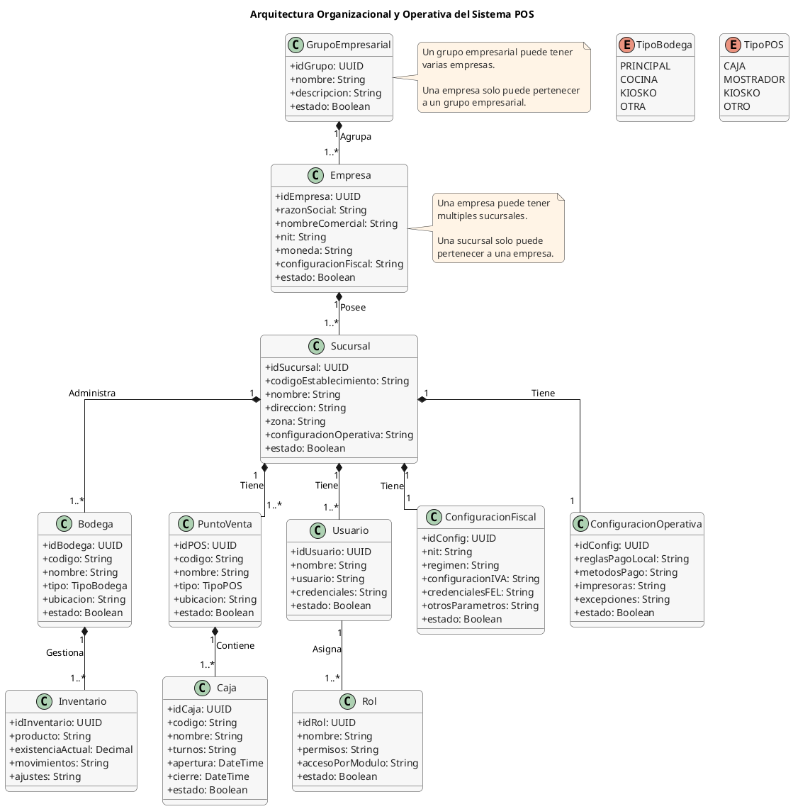

# SISTEMI POS Restaurante — Estructura Organizacional y Operativa

## 1. Diagrama de Arquitectura Organizacional y Operativa

---

## 2. Descripción de Componentes y Correspondencia en Código

### 2.1. Grupo Empresarial (`BusinessGroup`)
- **Clase C#:** `SistemiPos.Domain.Organizations.BusinessGroup`
- **Tabla PostgreSQL:** `BusinessGroups`
- **Función:** Representa el consorcio o corporativo de más alto nivel.
- **Campos principales:** `Id` (UUID), `Code`, `Name`, `Description`, `IsActive`.
- **Regla:** Un grupo empresarial puede tener varias empresas (`IReadOnlyCollection<Company>`).

### 2.2. Empresa (`Company`)
- **Clase C#:** `SistemiPos.Domain.Organizations.Company`
- **Tabla PostgreSQL:** `Companies`
- **Función:** Entidad jurídica tributaria con personería ante la SAT.
- **Campos principales:** `Id` (UUID), `BusinessGroupId` (FK), `Code`, `LegalName`, `TradeName`, `Nit`, `Address`, `Phone`, `Email`, `TaxRegime`, `IsActive`.
- **Regla:** Una empresa solo puede pertenecer a un grupo empresarial y puede tener múltiples sucursales.

### 2.3. Sucursal (`Branch`)
- **Clase C#:** `SistemiPos.Domain.Organizations.Branch`
- **Tabla PostgreSQL:** `Branches`
- **Función:** Punto de venta físico o establecimiento comercial.
- **Campos principales:** `Id` (UUID), `CompanyId` (FK), `Code`, `Name`, `Address`, `Phone`, `TimeZone`, `EstablishmentCode`, `IsActive`.
- **Regla:** Una sucursal pertenece estrictamente a una empresa (`CompanyId`). Administra una o varias bodegas y contiene puntos de venta / cajas.

### 2.4. Bodega (`Warehouse`)
- **Clase C#:** `SistemiPos.Domain.Organizations.Warehouse`
- **Tabla PostgreSQL:** `Warehouses`
- **Función:** Ubicación física de almacenamiento y control de existencias.
- **Campos principales:** `Id` (UUID), `BranchId` (FK), `Code`, `Name`, `Description`, `IsDefault` (Principal), `IsKitchen` (Cocina), `IsActive`.
- **Regla:** Cada bodega pertenece a una sucursal. El índice único compuesto `(BranchId, Code)` impide duplicación de códigos dentro de la misma sucursal.

### 2.5. Inventario (`InventoryStock` e `InventoryMovement`)
- **Clase C#:** `SistemiPos.Domain.Inventory.InventoryStock`
- **Tabla PostgreSQL:** `InventoryStocks`
- **Función:** Control de existencia actual por producto y por bodega.
- **Campos principales:** `Id` (UUID), `ProductId` (FK), `WarehouseId` (FK), `CurrentStock` (numeric 18,2).
- **Regla:** Índice compuesto único `(ProductId, WarehouseId)` que garantiza control granular por ubicación física. El Kardex (`InventoryMovement`) registra el `WarehouseId` en cada entrada, salida o ajuste.

### 2.6. Punto de Venta (POS) y Caja (`PosDevice` y `CashSession`)
- **Clases C#:** `SistemiPos.Domain.Configuration.PosDevice` y `SistemiPos.Domain.Cash.CashSession`
- **Tablas PostgreSQL:** `PosDevices`, `CashSessions`, `CashSessionPosDevices`
- **Función:** Operación de cobro, terminales POS físicas y sesiones de apertura/cierre de turnos de cajero.
- **Campos principales:** `CashSession` contiene `BranchId`, `RegisterCode`, `CashierUserName`, montos iniciales y finales, y arqueos vinculados a terminales `PosDevice`.

### 2.7. Usuario, Rol y Alcance (`AppUser`, `AppRole`, `UserScopeAssignment`)
- **Clases C#:** `SistemiPos.Infrastructure.Security.AppUser`, `AppRole`, `SistemiPos.Domain.Organizations.UserScopeAssignment`
- **Tablas PostgreSQL:** `AspNetUsers`, `AspNetRoles`, `UserScopeAssignments`
- **Función:** Gestión de identidad, permisos modulares y restricción de ámbito operacional.
- **Regla:** `UserScopeAssignment` determina si el usuario opera a nivel de todo el `BusinessGroup`, de una `Company` o de una `Branch` específica (`UserScopeLevel`).

### 2.8. Configuración Fiscal y Operativa (`CompanySetting` y `BranchSetting`)
- **Clases C#:** `SistemiPos.Domain.Organizations.CompanySetting` y `SistemiPos.Domain.Organizations.BranchSetting`
- **Tablas PostgreSQL:** `CompanySettings`, `BranchSettings`
- **Servicio de Resolución:** `SistemiPos.Application.Organizations.EnterpriseSettingsResolver`
- **Regla de Precedencia:**  
  $$\text{Valor Efectivo} = \text{Excepción de Sucursal} \;\;??\;\; \text{Predeterminado de Empresa} \;\;??\;\; \text{Fallback de Sistema}$$
  * **Fiscal:** El NIT, Razón Social, IVA y credenciales FEL son definidos a nivel de Empresa (`CompanySetting`) y cada sucursal aporta su Código de Establecimiento SAT.
  * **Operativa:** La sucursal (`BranchSetting`) puede activar excepciones de métodos de pago permitidos (`Cash`, `Transfer`, `Pos`, `Credit`) y pie de ticket personalizado (`ReceiptFooter`).

---

## 3. Matriz de Integridad y Aislamiento

1. **Aislamiento Multitenant:** El backend (`EnterpriseSettingsResolver`) valida que toda sucursal pertenezca a la empresa consultada (`branch.CompanyId == companyId`). Cualquier discrepancia es bloqueada inmediatamente con `DomainRuleException`.
2. **Aislamiento entre Sucursales:** Las modificaciones realizadas en los parámetros de la Sucursal A no afectan los valores de la Sucursal B ni los de la Empresa.
3. **Persistencia Histórica:** Las ventas, transacciones y cortes pasados permanecen inmutables y no son recalculados ante cambios de configuración.

---

## 4. Verificación de Criterios de Aceptación (Checklist de la Historia)

A continuación se detalla cómo el sistema cumple de manera demostrable y verificable cada uno de los criterios del requerimiento:

### ✅ 1. El sistema manejará una empresa con múltiples sucursales
* **En el código:** `Company` (`src/SistemiPos.Domain/Organizations/Company.cs`) mantiene la relación 1 a muchos `IReadOnlyCollection<Branch> Branches`. Cada `Branch` tiene la clave foránea obligatoria `CompanyId` hacia su empresa padre.
* **En la base de datos (PostgreSQL):** La tabla `Branches` tiene la clave foránea `FK_Branches_Companies_CompanyId` con `OnDelete: Restrict` e índice de búsqueda.
* **Aislamiento Multitenant:** En la capa de aplicación (`EnterpriseSettingsResolver.cs`), el backend valida estrictamente que la sucursal pertenezca a la empresa (`if (branch.CompanyId != companyId) throw new DomainRuleException(...)`). No se permite la mezcla o consulta cruzada de sucursales entre empresas distintas.
* **Operatividad:** El módulo organizacional (`OrganizationService.cs` y `OrganizationController.cs`) permite dar de alta múltiples sucursales para una misma empresa, asignarles bodegas independientes y usuarios autorizados.

### ✅ 2. Los parámetros generales funcionan como valores por defecto cuando no exista una configuración específica por sucursal
* **Plantilla Institucional:** La entidad `CompanySetting` define los parámetros generales por defecto (Razón Social, NIT, Moneda, Impuestos IVA, Pie de recibo institucional, Métodos de pago globales y Credenciales FEL).
* **Excepciones de Sucursal:** La entidad `BranchSetting` modela exclusivamente las excepciones permitidas a nivel local (código y nombre de establecimiento SAT, pie de recibo específico y métodos de pago permitidos en esa sede).
* **Servicio Central de Resolución:** `EnterpriseSettingsResolver` ejecuta la jerarquía:
  $$\text{Valor Efectivo} = \text{Excepción Sucursal} \;\;??\;\; \text{Valor Empresa} \;\;??\;\; \text{Fallback Sistema}$$
* **Trazabilidad de Origen:** Cada valor retornado es un `EffectiveValue<T>(T Value, SettingOrigin Origin)`. Si la sucursal no tiene excepción, el sistema retorna el valor de la empresa con `Origin = SettingOrigin.Company`. Si la sucursal sobreescribe el parámetro, se retorna el valor local con `Origin = SettingOrigin.Branch`.
* **Evidencia de Pruebas:** Verificado y aprobado mediante pruebas unitarias en `EnterpriseSettingsResolverTests.cs` (`Resolve_BranchWithoutOverride_InheritsCompanySettings` y `Resolve_BranchWithOverride_ReturnsBranchValuesAndBranchOrigin`).

### ✅ 3. Los cambios de configuración sensibles deben quedar auditados
* **Trazabilidad en Entidades:** Tanto `CompanySetting` como `BranchSetting` heredan de `AuditableEntity`, asegurando la captura obligatoria de:
  * `CreatedAtUtc` y `CreatedBy` (momento UTC y usuario creador).
  * `ModifiedAtUtc` y `ModifiedBy` (momento UTC y usuario que realizó la modificación).
* **Bitácora Transaccional:** `AuditSaveChangesInterceptor` intercepta automáticamente cualquier cambio en `CompanySettings` y `BranchSettings`, registrándolo en la tabla `AuditLogs` dentro de la **misma transacción atómica** de la base de datos (si la auditoría falla, el cambio de configuración no se aplica).
* **Protección de Secretos:** Las credenciales FEL (`InfileApiKeyProtected`, etc.) se almacenan cifradas mediante `IDataProtectionProvider`. En la unidad ORG-09D se asegura adicionalmente que `ChangesJson` redacte/enmascare cualquier clave o secreto para que no se almacenen en texto claro dentro de la bitácora de auditoría ni en logs del servidor.

