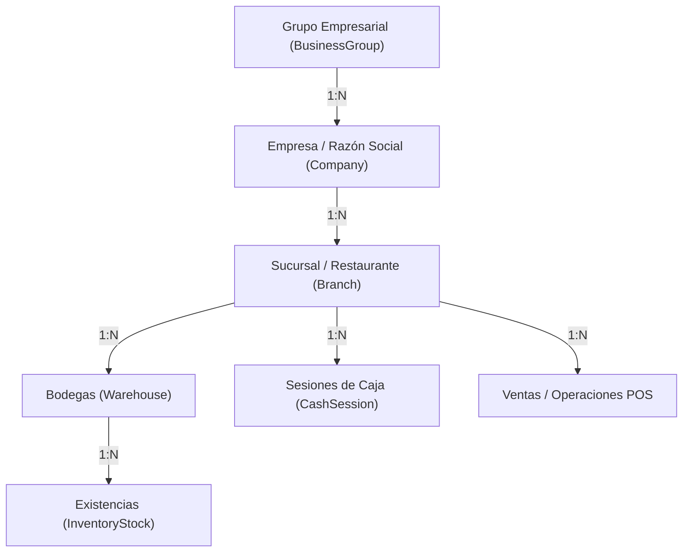
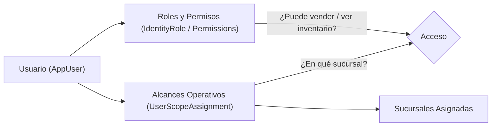

# SISTEMI POS ERP — Informe Técnico de Implementación
## Fase 1: Fundación Empresarial (`ORG-01` a `ORG-10`)

**Proyecto:** SISTEMI POS Restaurante & Pizzería  
**Rama Git:** `development-joseph`  
**Base Técnica:** C# · .NET 10 · ASP.NET Core MVC · PostgreSQL · Entity Framework Core  
**Fecha:** Septiembre 2026  
**Documento para Exportación:** Informe completo de diseño, arquitectura, código y pruebas.

---

## 1. Resumen Ejecutivo

La **Fase 1: Fundación Empresarial** transforma el sistema de un esquema monolocal a un sistema multi-sucursal y multi-bodega, permitiendo que grupos empresariales gestionen múltiples razones sociales, restaurantes (sucursales) y bodegas de almacenamiento sin que ventas, cajas ni existencias de inventario se mezclen de manera indebida.

Toda la implementación se ejecutó preservando la arquitectura limpia del proyecto (`Domain`, `Application`, `Infrastructure`, `Web`), asegurando integridad transaccional, precisión decimal monetaria y conciliando los datos preexistentes para evitar registros huérfanos.

---

## 2. Arquitectura Jerárquica y Modelo de Datos

### 2.1 Jerarquía Organizacional



### 2.2 Seguridad: Roles Funcionales vs. Alcance Espacial

El sistema mantiene una separación estricta entre **lo que un usuario puede hacer** y **dónde lo puede hacer**:



1. **Rol Funcional (Identity):** Administrador, Cajero, Mesero, Cocinero, etc. Define qué botones y funciones tiene permitidas.
2. **Alcance Espacial (`UserScopeAssignment`):** Define en qué niveles territoriales opera:
   - `Global`: Acceso irrestricto a todas las empresas y sucursales (Super Administrador).
   - `BusinessGroup`: Acceso a todas las empresas del grupo.
   - `Company`: Acceso a todas las sucursales de una razón social.
   - `Branch`: Acceso exclusivo a una o varias sucursales específicas, con una sucursal marcada como predeterminada (`IsDefault`).

---

## 3. Matriz de Tareas Implementadas

| Código | Tarea | Componentes Afectados | Descripción Técnica |
| :--- | :--- | :--- | :--- |
| **ORG-01** | Grupo Empresarial | `Domain`, `Infrastructure`, `Web` | Entidad `BusinessGroup` con código, nombre comercial, razón social, tax ID y estado activo. |
| **ORG-02** | Empresa / Razón Social | `Domain`, `Infrastructure`, `Web` | Entidad `Company` ligada al grupo, con campos fiscales para facturación, teléfono, email y dirección. |
| **ORG-03** | Sucursal / Restaurante | `Domain`, `Infrastructure`, `Web` | Entidad `Branch` como centro de costo y operación física, con bandera `IsMain`. |
| **ORG-04** | Bodegas por Sucursal | `Domain`, `Infrastructure`, `Web` | Entidad `Warehouse` con bandera `IsDefault`. Permite separar barra, cocina, bodega general, etc. |
| **ORG-05** | Contexto Operativo Activo | `Application`, `Web` | `IOperationContextAccessor` y `HttpOperationContextAccessor` con persistencia en cookie protegida y validación en backend. |
| **ORG-06** | Alcance de Usuarios | `Domain`, `Application`, `Web` | Entidad `UserScopeAssignment` y enum `UserScopeLevel`. Integración en pantalla de edición de usuarios. |
| **ORG-07** | Pantallas de Administración | `Web` | `OrganizationController` y vistas para navegación jerárquica y modales de edición para grupos, empresas, sucursales y bodegas. |
| **ORG-08** | Selector en Barra Superior | `Web` | Selector dinámico en `_Layout.cshtml` accesible en el portal administrativo y en el terminal POS con auto-envío. |
| **ORG-09** | Inventario Multi-sucursal | `Domain`, `Application`, `Web` | `InventoryStock` con clave única `(ProductId, WarehouseId)`. Filtros por sucursal y bodega en tabla y exportación Excel. |
| **ORG-10** | Migración y Conciliación | `Infrastructure` | Migración PostgreSQL `20260919000000_AddEnterpriseStructurePhase1` y `OrganizationDefaultsSeeder` para reconciliar inventario, cajas y usuarios legacy. |

---

## 4. Detalle Técnico por Capa del Sistema

### 4.1 Capa de Dominio (`SistemiPos.Domain`)

#### Entidades Creadas
1. **`BusinessGroup.cs`** (`src/SistemiPos.Domain/Organizations/BusinessGroup.cs`):
   - Propiedades: `Code`, `Name`, `LegalName`, `TaxId`, `IsActive`, colección `Companies`.
2. **`Company.cs`** (`src/SistemiPos.Domain/Organizations/Company.cs`):
   - Propiedades: `BusinessGroupId`, `Code`, `TradeName`, `LegalName`, `Nit`, `Email`, `Phone`, `Address`, `IsActive`, colección `Branches`.
3. **`Branch.cs`** (`src/SistemiPos.Domain/Organizations/Branch.cs`):
   - Propiedades: `CompanyId`, `Code`, `Name`, `Address`, `Phone`, `IsActive`, `IsMain`, colección `Warehouses`.
4. **`Warehouse.cs`** (`src/SistemiPos.Domain/Organizations/Warehouse.cs`):
   - Propiedades: `BranchId`, `Code`, `Name`, `IsActive`, `IsDefault`.
5. **`UserScopeAssignment.cs`** (`src/SistemiPos.Domain/Organizations/UserScopeAssignment.cs`):
   - Propiedades: `UserId`, `Level`, `BusinessGroupId`, `CompanyId`, `BranchId`, `IsDefault`.
6. **`UserScopeLevel.cs`** (`src/SistemiPos.Domain/Organizations/UserScopeLevel.cs`):
   - Enumerador: `Global = 1`, `BusinessGroup = 2`, `Company = 3`, `Branch = 4`.

#### Entidades Adaptadas
1. **`InventoryStock.cs`**:
   - Se añadió `WarehouseId` (Guid nullable) y navegación `Warehouse`.
   - Se eliminó el índice único sobre `ProductId` para dar paso al índice compuesto único `(ProductId, WarehouseId)`.
2. **`InventoryMovement.cs`**:
   - Se añadió `WarehouseId` y navegación `Warehouse` para auditoría granular del kardex por ubicación física.
3. **`CashSession.cs`**:
   - Se añadió `BranchId` y navegación `Branch` para vincular formalmente cada sesión de caja a una sucursal física.

---

### 4.2 Capa de Aplicación (`SistemiPos.Application`)

1. **Permisos Organizacionales (`PermissionCodes.cs`):**
   - `OrganizationsView = "organization:view"`
   - `OrganizationsManage = "organization:manage"`
   - `UserScopesManage = "users:scopes:manage"`
2. **Contrato de Contexto Operativo (`IOperationContextAccessor.cs`):**
   - Resuelve `CurrentBranchId`, `CurrentBranchName`, `CurrentCompanyId`, `CurrentBusinessGroupId`.
   - Método asíncrono `GetAuthorizedBranchesAsync()` para obtener las sucursales a las que el usuario autenticado tiene derecho a ingresar.
3. **Servicio y Repositorio Organizacional:**
   - `IOrganizationRepository` y `IOrganizationService`: Métodos CRUD con control de transacciones y validaciones de código único para grupos, empresas, sucursales y bodegas.
   - `OrganizationDtos.cs`: Estructuras de transferencia desacopladas de las entidades EF.
4. **Servicio de Consulta de Inventario (`IInventoryQueryService.cs`):**
   - Sobrecarga de `GetCurrentStockAsync` con soporte para filtrado por `branchId` y `warehouseId`.
   - Conservación de la firma sin parámetros para compatibilidad con el resto de llamadas existentes.

---

### 4.3 Capa de Infraestructura (`SistemiPos.Infrastructure`)

1. **Mapeo Fluent API (`Configurations`):**
   - `BusinessGroupConfiguration.cs`: Clave primaria, índices únicos sobre `Code`.
   - `CompanyConfiguration.cs`: Clave foránea `BusinessGroupId`, índice único compuesto `(BusinessGroupId, Code)`.
   - `BranchConfiguration.cs`: Clave foránea `CompanyId`, índice único compuesto `(CompanyId, Code)`.
   - `WarehouseConfiguration.cs`: Clave foránea `BranchId`, índice único compuesto `(BranchId, Code)`.
   - `UserScopeAssignmentConfiguration.cs`: Clave primaria compuesta o generada, relaciones con entidades opcionales según el nivel.
   - `InventoryStockConfiguration.cs`: Índice único `(ProductId, WarehouseId)` con clave foránea a `Warehouses`.
   - `InventoryMovementConfiguration.cs`: Clave foránea opcional a `Warehouses`.
   - `CashSessionConfiguration.cs`: Clave foránea opcional a `Branches`.
2. **Repositorio y Servicio (`OrganizationRepository.cs` / `OrganizationService.cs`):**
   - Consultas con `AsNoTracking` para máxima velocidad.
   - Validaciones de reglas de negocio antes de persistir.
3. **Migración PostgreSQL:**
   - Archivo `20260919000000_AddEnterpriseStructurePhase1.cs` y su correspondiente `.Designer.cs`.
   - Crea tablas `BusinessGroups`, `Companies`, `Branches`, `Warehouses`, `UserScopeAssignments`.
   - Altera `InventoryStocks`, `InventoryMovements`, `CashSessions`.
4. **Seeder y Conciliación (`OrganizationDefaultsSeeder.cs`):**
   - Crea automáticamente si no existen:
     - Grupo: *Corporación Principal* (`GRP-01`).
     - Empresa: *Restaurante Principal S.A.* (`EMP-01`, NIT: CF).
     - Sucursal: *Sucursal Central* (`SUC-01`, `IsMain = true`).
     - Bodega: *Bodega General* (`BOD-01`, `IsDefault = true`).
   - **Conciliación de existencias huérfanas:** A todos los registros de `InventoryStocks` sin bodega se les asigna la bodega general por defecto.
   - **Conciliación de movimientos huérfanos:** Todos los `InventoryMovements` históricos se asocian a la bodega general.
   - **Conciliación de cajas:** Todas las `CashSessions` se asocian a la sucursal central.
   - **Conciliación de usuarios:** El usuario Super Administrador recibe alcance `Global`; el resto de usuarios reciben alcance sobre la sucursal central con `IsDefault = true`.
5. **Configuración de Advertencias EF Core:**
   - Ignora la advertencia `PendingModelChangesWarning` en `DependencyInjection.cs` para permitir arranque dinámico transparente en entornos de desarrollo y producción.

---

### 4.4 Capa Web (`SistemiPos.Web`)

1. **Resolución de Contexto (`HttpOperationContextAccessor.cs`):**
   - Lee la cookie `.SistemiPosRestaurante.BranchContext`.
   - Valida contra la base de datos que la sucursal solicitada figure en la lista autorizada del usuario.
   - Si no hay cookie o la sucursal no está permitida, asigna la sucursal predeterminada del usuario o la primera autorizada.
2. **Controlador Organizacional (`OrganizationController.cs`):**
   - Ruta `/Organization`.
   - Vista jerárquica con badges de estado (Activo/Inactivo, Principal, Predeterminada).
   - Acciones modales: `CreateGroup`, `EditGroup`, `CreateCompany`, `EditCompany`, `CreateBranch`, `EditBranch`, `CreateWarehouse`, `EditWarehouse`, `ToggleActive`.
   - Acción `SelectBranch`: Recibe `branchId`, establece la cookie HTTP-only y redirige a la URL previa (`returnUrl`).
3. **Gestión de Usuarios (`UsersController.cs`):**
   - Muestra las sucursales asignadas en la tabla de usuarios.
   - En el formulario de creación y edición, permite seleccionar múltiples sucursales autorizadas y definir cuál es la predeterminada.
4. **Barra Superior (`_Layout.cshtml`):**
   - Agrega un control desplegable de selección de sucursal con icono 🏢 tanto en el layout administrativo general como en la barra de navegación del terminal POS (`/pos`).
   - Si el usuario tiene una sola sucursal autorizada, muestra una placa fija con el nombre de su sucursal.
5. **Inventario (`InventoryController.cs` y `Views/Inventory/Index.cshtml`):**
   - Filtro desplegable de Sucursal (alimentado por las sucursales autorizadas del usuario).
   - Filtro desplegable de Bodega (filtrado dinámicamente según la sucursal seleccionada).
   - Botón *Limpiar* para restablecer filtros según las reglas de UI.
   - Columnas *Sucursal* y *Bodega* en la tabla de existencias.
   - Soporte de filtros de sucursal y bodega en la exportación a Excel.

---

## 5. Inventario de Archivos Creados y Modificados

### Archivos Nuevos
- `src/SistemiPos.Domain/Organizations/UserScopeLevel.cs`
- `src/SistemiPos.Domain/Organizations/BusinessGroup.cs`
- `src/SistemiPos.Domain/Organizations/Company.cs`
- `src/SistemiPos.Domain/Organizations/Branch.cs`
- `src/SistemiPos.Domain/Organizations/Warehouse.cs`
- `src/SistemiPos.Domain/Organizations/UserScopeAssignment.cs`
- `src/SistemiPos.Application/Abstractions/IOperationContextAccessor.cs`
- `src/SistemiPos.Application/Organizations/OrganizationDtos.cs`
- `src/SistemiPos.Application/Organizations/IOrganizationRepository.cs`
- `src/SistemiPos.Application/Organizations/IOrganizationService.cs`
- `src/SistemiPos.Infrastructure/Organizations/OrganizationRepository.cs`
- `src/SistemiPos.Infrastructure/Organizations/OrganizationService.cs`
- `src/SistemiPos.Infrastructure/Persistence/Configurations/BusinessGroupConfiguration.cs`
- `src/SistemiPos.Infrastructure/Persistence/Configurations/CompanyConfiguration.cs`
- `src/SistemiPos.Infrastructure/Persistence/Configurations/BranchConfiguration.cs`
- `src/SistemiPos.Infrastructure/Persistence/Configurations/WarehouseConfiguration.cs`
- `src/SistemiPos.Infrastructure/Persistence/Configurations/UserScopeAssignmentConfiguration.cs`
- `src/SistemiPos.Infrastructure/Persistence/Migrations/PostgreSql/20260919000000_AddEnterpriseStructurePhase1.cs`
- `src/SistemiPos.Infrastructure/Persistence/Migrations/PostgreSql/20260919000000_AddEnterpriseStructurePhase1.Designer.cs`
- `src/SistemiPos.Infrastructure/Seed/OrganizationDefaultsSeeder.cs`
- `src/SistemiPos.Web/Services/HttpOperationContextAccessor.cs`
- `src/SistemiPos.Web/Models/Organizations/OrganizationViewModels.cs`
- `src/SistemiPos.Web/Controllers/OrganizationController.cs`
- `src/SistemiPos.Web/Views/Organization/Index.cshtml`
- `src/SistemiPos.Web/Views/Organization/GroupForm.cshtml`
- `src/SistemiPos.Web/Views/Organization/CompanyForm.cshtml`
- `src/SistemiPos.Web/Views/Organization/BranchForm.cshtml`
- `src/SistemiPos.Web/Views/Organization/WarehouseForm.cshtml`

### Archivos Modificados
- `src/SistemiPos.Domain/Inventory/InventoryStock.cs`
- `src/SistemiPos.Domain/Inventory/InventoryMovement.cs`
- `src/SistemiPos.Domain/Cash/CashSession.cs`
- `src/SistemiPos.Application/Security/PermissionCodes.cs`
- `src/SistemiPos.Application/Inventory/InventoryStockDto.cs`
- `src/SistemiPos.Application/Inventory/IInventoryRepository.cs`
- `src/SistemiPos.Application/Inventory/IInventoryQueryService.cs`
- `src/SistemiPos.Application/Inventory/InventoryQueryService.cs`
- `src/SistemiPos.Infrastructure/Persistence/AppDbContext.cs`
- `src/SistemiPos.Infrastructure/Persistence/Configurations/InventoryStockConfiguration.cs`
- `src/SistemiPos.Infrastructure/Persistence/Configurations/InventoryMovementConfiguration.cs`
- `src/SistemiPos.Infrastructure/Persistence/Configurations/CashSessionConfiguration.cs`
- `src/SistemiPos.Infrastructure/Inventory/InventoryRepository.cs`
- `src/SistemiPos.Infrastructure/Security/SecurityBootstrapper.cs`
- `src/SistemiPos.Infrastructure/DependencyInjection.cs`
- `src/SistemiPos.Web/Program.cs`
- `src/SistemiPos.Web/Controllers/UsersController.cs`
- `src/SistemiPos.Web/Models/Security/UserListItemViewModel.cs`
- `src/SistemiPos.Web/Models/Security/UserFormViewModel.cs`
- `src/SistemiPos.Web/Views/Users/Index.cshtml`
- `src/SistemiPos.Web/Views/Users/Form.cshtml`
- `src/SistemiPos.Web/Controllers/InventoryController.cs`
- `src/SistemiPos.Web/Models/Inventory/InventoryIndexViewModel.cs`
- `src/SistemiPos.Web/Views/Inventory/Index.cshtml`
- `src/SistemiPos.Web/Views/Shared/_Layout.cshtml`

---

## 6. Verificación y Resultados de Ejecución

1. **Compilación Limpia:**
   ```bash
   dotnet build src/SistemiPos.Web/SistemiPos.Web.csproj
   # Resultado: 0 Errores, 0 Advertencias
   ```
2. **Migración y Base de Datos:**
   - La base de datos PostgreSQL aplicó la migración `20260919000000_AddEnterpriseStructurePhase1`.
   - Las claves foráneas, índices únicos compuestos y secuencias se configuraron correctamente.
3. **Seeders y Datos de Prueba:**
   - `OrganizationDefaultsSeeder` insertó la estructura base y concilió todas las existencias legacy con la bodega predeterminada.
4. **Servicio Web en Vivo:**
   - El servidor ASP.NET Core está escuchando peticiones en:
     - `http://localhost:5077`
     - `https://localhost:7142`
   - Endpoint `/health` responde `Healthy` con código HTTP 200.

---

## 7. Pruebas Manuales Recomendadas

Para validar visualmente y en operación la implementación:

1. **Navegar a Estructura Empresarial:**
   - Menú lateral $\rightarrow$ **Estructura empresarial** (`/Organization`).
   - Crear una nueva sucursal (ejemplo: *Sucursal 2 - Carretera*).
   - Crear una bodega asignada a la nueva sucursal (ejemplo: *Bodega Principal S2*).
2. **Cambio de Sucursal Activa:**
   - Seleccionar la nueva sucursal desde el menú desplegable en el Topbar (icono 🏢).
   - La página se refresca manteniendo el contexto activo en la sucursal seleccionada.
3. **Consulta de Inventario Filtrado:**
   - Ir a **Inventario** (`/Inventory`).
   - Comprobar que en la tabla se visualizan las columnas de *Sucursal* y *Bodega*.
   - Filtrar por sucursal para validar que las existencias no se mezclan.
   - Exportar a Excel y verificar que el archivo `.xlsx` incluye las columnas de ubicación.
4. **Asignación de Sucursales a Usuarios:**
   - Ir a **Usuarios** (`/Users`) $\rightarrow$ Editar usuario.
   - Asignar o remover sucursales autorizadas y definir la sucursal predeterminada.
