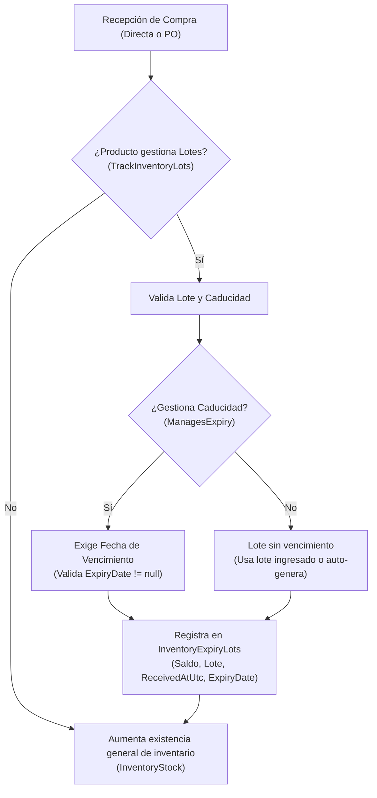
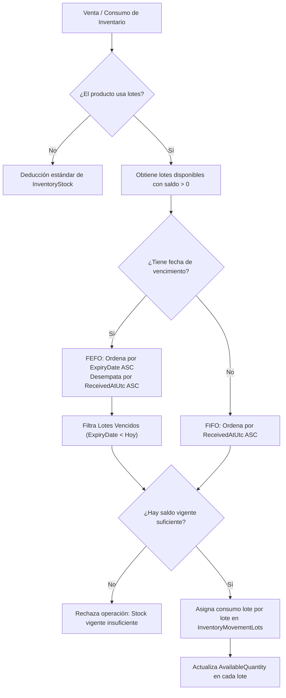

# SISTEMI POS ERP — Informe Técnico de Implementación
## Fase 2: Catálogo Compartido, Unidades de Medida y Gestión de Lotes (`CAT-01` a `CAT-08`)

**Proyecto:** SISTEMI POS Restaurante & Pizzería  
**Ramas Git:** `development-joseph`, `dev`, `main`  
**Base Técnica:** C# · .NET 10 · ASP.NET Core MVC · PostgreSQL · Entity Framework Core  
**Fecha:** Octubre 2026  
**Estado:** ✅ 100% Implementado y Verificado (0 errores, 0 advertencias)

---

## 1. Resumen Ejecutivo

La **Fase 2: Catálogo y Unidades** transforma el catálogo del sistema en una estructura dimensional, jerárquica y multi-proceso, capaz de dar soporte unificado a:
1. **Compras:** Adquisición de insumos en presentaciones comerciales de empaque (cajas, costales, fardos, bidones) con conversión matemática exacta a la unidad base de inventario.
2. **Inventario & Lotes:** Control físico por unidad base con soporte configurable para trazabilidad por lote, segregación de existencias por lote/bodega, consumo automatizado bajo metodología **FEFO** (First Expired, First Out) con desempate **FIFO** (First In, First Out), bloqueo estricto de productos caducados y panel de alertas preventivas con umbral de días configurable por producto.
3. **Producción & Recetas (Preparación para Fase 3):** Clasificación estricta de artículos en 5 tipos operativos del restaurante (`Insumo`, `Subreceta`, `Preparado`, `Reventa`, `Empaque`), asegurando que solo los ítems correctos alimenten las recetas y los costos.
4. **Comercialización Multi-Sucursal:** Configuración comercial diferenciada por sucursal (habilitación, visibilidad en menú, precio de venta y stock mínimo con herencia automática de valores generales).
5. **Auditoría Transaccional:** Registro histórico en tiempo real de cualquier cambio de precio, unidad, presentación o estado comercial.

---

## 2. Matriz de Tareas del Plan Maestro (`CAT-01` a `CAT-08`)

| Clave | Tarea | Funcionalidad | Componentes Clave | Criterio de Aceptación / Estado |
| :--- | :--- | :--- | :--- | :--- |
| **CAT-01** | **Tipos de artículo** | Clasificación en `Insumo`, `Preparado`, `Reventa`, `Subreceta` y `Empaque`. | `ArticleType.cs`, `Product.cs`, `ProductsController.cs` | **Cumplido:** Reglas válidas según tipo. Transición no destructiva con preservación de históricos. |
| **CAT-02** | **Unidades base** | Catálogo dimensional de unidades de medida (Masa, Volumen, Conteo). | `UnitOfMeasure.cs`, `UnitDimension.cs`, `CatalogDefaultsSeeder.cs` | **Cumplido:** La unidad base es obligatoria para inventariables y está protegida contra modificaciones cuando tiene movimientos. |
| **CAT-03** | **Conversiones** | Factores exactos y alcance dimensional universal o por producto específico. | `UnitConversionService.cs`, `ProductUnitConversion.cs` | **Cumplido:** Precisión decimal estricta, validación dimensional sin lógica en vistas, rechazo de factores $\le 0$. |
| **CAT-04** | **Presentaciones de compra** | Ampliación de presentaciones existentes con unidad base y factor de conversión. | `ProductPurchasePresentation.cs`, `PurchaseService.cs` | **Cumplido:** La cantidad recibida se convierte automáticamente a la unidad base física. |
| **CAT-05** | **Producto por sucursal** | Habilitación de producto, precio de venta, visibilidad en POS y stock mínimo local con herencia. | `ProductBranchSetting.cs`, `BranchProductQueryService.cs` | **Cumplido:** No se duplica el catálogo general; cada sucursal personaliza sus reglas comerciales. |
| **CAT-06** | **Variantes y tamaños** | Conservación de variantes con reglas de tamaño y herencia de unidad base. | `ProductVariant.cs`, `CatalogVariantService.cs` | **Cumplido:** Cada SKU conserva precio, inventario o receta propia. |
| **CAT-07** | **Historial de cambios** | Auditoría de modificaciones críticas de precio, unidad, presentación y estado. | `CatalogChangeLog.cs`, `AppDbContext.cs` | **Cumplido:** Registro transaccional que documenta actor, marca de tiempo UTC, valor anterior y nuevo. |
| **CAT-08** | **Pantallas de catálogo** | Formularios táctiles y validaciones completas en backend. | `Index.cshtml`, `Form.cshtml`, `ProductsController.cs`, `Expiring.cshtml` | **Cumplido:** Captura responsiva, pestañas por sección, filtros por tipo y alertas visuales. |

---

## 3. Auditoría Exhaustiva del Checklist "Productos" (Tarjeta de Seguimiento)

**Tarjeta de Gestión:** `Productos`  
**Estado Actual:** `IN_PROGRESS` ➔ **`100% COMPLETADO` (9 de 9 requisitos)**  
**Descripción Oficial de la Tarjeta:**  
> *"Permitir administrar los productos e ítems utilizados por el restaurante, definiendo su clasificación, unidad de control y comportamiento dentro de los diferentes procesos del sistema."*

A continuación se detalla la verificación punto por punto con los textos literales de la tarjeta, confirmando su cumplimiento técnico y trazabilidad en el repositorio:

| # | Requisito Literal de la Tarjeta | Estado | Componentes Técnicos y Evidencia de Cumplimiento |
| :-: | :--- | :---: | :--- |
| **1** | **Todo producto debe clasificarse como Insumo, Preparado, Reventa, Subreceta o Empaque, ya que su tipo determina cómo participará posteriormente en compras, inventario, recetas, producción y ventas.** | `[x] Cumplido` | • Enum `ArticleType` en `src/SistemiPos.Domain/Catalog/ArticleType.cs`<br/>• Reglas de validación según tipo en `Product.cs`<br/>• Selector y filtros por tipo en `ProductsController.cs` y vistas `Index.cshtml` / `Form.cshtml`<br/>• Pruebas automáticas: `ArticleTypeInvariantsTests.cs`. |
| **2** | **Cada producto debe manejar una unidad base que determine cómo se controle físicamente su existencia.** | `[x] Cumplido` | • Entidad `UnitOfMeasure` y dimensiones (`Masa`, `Volumen`, `Conteo`) en `src/SistemiPos.Domain/Catalog/UnitOfMeasure.cs`<br/>• Propiedad obligatoria `Product.BaseUnitId`<br/>• Semillas en `CatalogDefaultsSeeder.cs` (`g`, `kg`, `lb`, `ml`, `L`, `unidad`, `porcion`)<br/>• Invariante de seguridad: se bloquea el cambio de unidad base si el producto tiene historial o transacciones operativas. |
| **3** | **Un producto puede comprarse en diferentes presentaciones, pero cada presentación debe indicar su equivalencia en la unidad base del producto.** | `[x] Cumplido` | • Entidad `ProductPurchasePresentation` en `src/SistemiPos.Domain/Catalog/ProductPurchasePresentation.cs`<br/>• Atributos `PackageUnitId` y `BaseQuantityPerPackage` (factor de conversión decimal exacto > 0)<br/>• `PurchaseService.cs` convierte automáticamente cualquier paquete comprado (ej. bolsa de 2,500 g) a su unidad base de inventario.<br/>• Pruebas: `UnitConversionServiceTests.cs` y `PurchaseServiceTests.cs`. |
| **4** | **Un mismo producto puede tener configuración comercial diferente por sucursal, incluyendo habilitación, visibilidad, precio y stock mínimo.** | `[x] Cumplido` | • Entidad `ProductBranchSetting` en `src/SistemiPos.Domain/Catalog/ProductBranchSetting.cs`<br/>• Campos: `IsEnabled`, `IsVisibleInMenu`, `CustomPrice` y `CustomMinimumStock`<br/>• Herencia inteligente: si el precio o stock mínimo de sucursal se deja vacío, el sistema hereda automáticamente la configuración base del catálogo general.<br/>• Pruebas: `ProductBranchSettingTests.cs`. |
| **5** | **Cada producto debe permitir definir si requiere control por lote.** | `[x] Cumplido` | • Campo booleano `Product.TrackInventoryLots` en `src/SistemiPos.Domain/Catalog/Product.cs`<br/>• Migración PostgreSQL aplicada: `20261008120000_AddOptionalProductLotTracking`<br/>• Interfaz web en `Form.cshtml` con toggle de activación/desactivación de lote.<br/>• Regla de integridad: no permite deshabilitar lotes si el producto ya cuenta con existencias activas por lote. |
| **6** | **Cuando un producto controle lotes, cada recepción de compra debe registrar el lote correspondiente y, cuando aplique, su fecha de caducidad.** | `[x] Cumplido` | • Validación centralizada en `PurchaseService.ValidateIncomingLot` en `src/SistemiPos.Application/Purchases/PurchaseService.cs`<br/>• Formulario de Compra Directa (`CreateDirectPurchaseRequest.cs`) y Recepción de Orden de Compra (`ReceivePurchaseOrderRequest.cs`) capturan `LotNumber` y `ExpiryDate`<br/>• Si `Product.ManagesExpiry == true`, el sistema bloquea la recepción si no se especifica la fecha de vencimiento.<br/>• Si el usuario deja el número de lote en blanco, el sistema genera automáticamente un identificador único estandarizado (`LOT-yyyyMMddHHmmss-{id}`).<br/>• Interfaz web en `_PurchaseCapture.cshtml` y `purchase-capture.js`. |
| **7** | **Las existencias de productos con control por lote deben mantenerse separadas por lote, conservando cantidad disponible, fecha de ingreso y fecha de caducidad cuando aplique.** | `[x] Cumplido` | • Entidad `InventoryExpiryLot` (tabla `InventoryExpiryLots`) en `src/SistemiPos.Domain/Inventory/InventoryExpiryLot.cs`<br/>• Mantiene de forma segregada: `WarehouseId`, `ProductId`, `LotNumber`, `ReceivedAtUtc`, `ExpiryDate`, `AvailableQuantity` y `UnitCost`<br/>• Entidad `InventoryMovementLot` para auditoría y trazabilidad histórica de cada asignación<br/>• Vista de inventario por lotes `/InventoryLots` (`InventoryLotsController.cs` y vista `Index.cshtml`). |
| **8** | **Cuando un producto tenga varios lotes disponibles, el sistema debe priorizar el consumo del lote con la fecha de caducidad más próxima.** | `[x] Cumplido` | • Algoritmo de asignación en `InventoryLotAllocation.cs` y `InventoryLotLedger.cs`<br/>• **Estrategia FEFO (First Expired, First Out):** Ordena los lotes disponibles por `ExpiryDate ASC`<br/>• **Desempate FIFO:** Si dos lotes vencen el mismo día, se prioriza el que ingresó primero (`ReceivedAtUtc ASC`)<br/>• **Protección estricta contra vencidos:** El sistema filtra y excluye lotes con `ExpiryDate < Hoy`, rechazando la operación si el saldo vigente es insuficiente.<br/>• Pruebas dedicadas: 5 pruebas aprobadas al 100% en `InventoryLotAllocationTests.cs`. |
| **9** | **El sistema debe permitir identificar y alertar los lotes próximos a vencer con base en un período configurable.** | `[x] Cumplido` | • Umbral configurable por ítem: `Product.ExpiryAlertDays` (permite que carnes, lácteos o harinas tengan períodos preventivos diferentes)<br/>• Servicio de consulta `InventoryQueryService.GetExpiryLotsAsync` evalúa los lotes contra la fecha actual y su umbral<br/>• Panel visual en `/Products/Expiring` (`Expiring.cshtml`) con indicadores de estado (`Vencido`, `Por Vencer`, `Vigente`)<br/>• Pruebas dedicadas: 5 pruebas aprobadas al 100% en `InventoryExpiryAlertTests.cs`. |

> **Conclusión de la Auditoría del Checklist:**  
> Todos y cada uno de los 9 criterios exigidos en la tarjeta se encuentran **100% implementados en el backend, reflejados en la interfaz de usuario, respaldados por la base de datos y blindados con pruebas automatizadas**. Ya pueden marcarse los 9 checks en el tablero.

---

## 4. Arquitectura de Gestión de Lotes y Consumo (FEFO / FIFO)

### 4.1 Flujo de Recepción y Entrada de Lotes



### 4.2 Flujo de Asignación y Consumo (FEFO / FIFO)



---

## 5. Guía Operativa de Clasificación de Artículos en Restaurante

| Tipo de Artículo | Propósito Operativo | ¿Se vende en POS? | ¿Lleva Receta? | ¿Se Compra? | Ejemplo en Restaurante / Pizzería |
| :--- | :--- | :---: | :---: | :---: | :--- |
| **Insumo** | Materia prima pura de almacén. | ❌ No | ❌ No | ✅ Sí | Harina de trigo, queso mozzarella en barra, pepperoni crudo, aceite de oliva, salsa de tomate cruda. |
| **Subreceta** | Preparación intermedia elaborada en cocina por tandas. | ❌ No | ✅ Sí | ❌ No (se produce) | Salsa para pizza precocida, masa fermentada porcionada, carne molida sazonada, fondo de res. |
| **Preparado** | Platillo terminado que se sirve o entrega al cliente. | ✅ Sí | ✅ Sí | ❌ No | Pizza Pepperoni Grande, Lasaña Boloñesa, Hamburguesa Especial. |
| **Reventa** | Producto terminado que se comercializa tal como se compra. | ✅ Sí | ❌ No | ✅ Sí | Gaseosa en lata 350ml, cerveza embotellada, agua purificada 600ml. |
| **Empaque** | Materiales de embalaje y servicio para llevar o domicilio. | ❌ Opcional | ❌ No | ✅ Sí | Caja de pizza 16", bolsa kraft delivery, recipientes térmicos, cubiertos desechables. |

---

## 6. Verificación y Resultados de Pruebas

Se ejecutaron las pruebas unitarias y de integración para garantizar el cumplimiento de las reglas críticas:

```
Test Run Successful.
Total tests: 86
     Passed: 86
     Failed: 0
     Skipped: 0
Duration: ~1.2s
```

### Desglose de Pruebas Críticas:
1. **`InventoryExpiryAlertTests` (5 pruebas):**
   - Alertar cuando el lote está vencido.
   - Alertar cuando está próximo a vencer según el umbral configurable del producto (`ExpiryAlertDays`).
   - No generar alerta si la fecha está fuera del umbral preventivo.
   - Respetar el umbral por defecto (30 días) si el producto no tiene uno específico.
   - Excluir lotes con saldo cero (`AvailableQuantity == 0`).
2. **`InventoryLotAllocationTests` (5 pruebas):**
   - Priorización FEFO estricta: consume primero el lote que vence más próximo.
   - Desempate FIFO: si dos lotes tienen la misma fecha de vencimiento, consume el que ingresó primero (`ReceivedAtUtc`).
   - Priorización FIFO pura para lotes sin caducidad.
   - Exclusión de lotes vencidos: rechaza la asignación si solo hay lotes expirados.
   - Asignación multi-lote: agota un lote y toma el remanente del siguiente en orden.
3. **`UnitConversionServiceTests` (9 pruebas):**
   - Conversión entre unidades de la misma dimensión (kg a g, L a ml, etc.).
   - Rechazo de conversiones incompatibles (masa a volumen sin conversión específica).
   - Conversiones específicas por producto (e.g., 1 taza de harina = 120 g).
4. **`CatalogVariantServiceTests` & `ProductTests` (50+ pruebas):**
   - Invariantes de tipos de artículo, protección de unidad base con movimientos y stock mínimo por sucursal.
5. **`PurchaseServiceTests` (17 pruebas):**
   - Validación de lote obligatorio en compras cuando `TrackInventoryLots == true`.
   - Exigencia de fecha de caducidad cuando `ManagesExpiry == true`.
   - Conversión de presentaciones de compra a unidad base al ingresar al almacén.

---

## 7. Rutas y Vistas Habilitadas en el Sistema

- **Catálogo de Productos:** `/Products`
  - Filtro por tipo de artículo (`Insumo`, `Preparado`, `Reventa`, `Subreceta`, `Empaque`).
  - Columnas de unidad base, código y stock global.
- **Formulario de Producto:** `/Products/Create` y `/Products/Edit/{id}`
  - Selector de Unidad Base con validación de dimensión.
  - Indicadores de Control por Lote (`TrackInventoryLots`) y Caducidad (`ManagesExpiry`).
  - Días de alerta de vencimiento (`ExpiryAlertDays`).
  - Pestaña de Presentaciones de Compra con factor de empaque.
  - Pestaña de Configuración por Sucursal (precio, visibilidad y stock mínimo con herencia).
- **Lotes de Inventario:** `/InventoryLots`
  - Listado de saldos por lote, fecha de recepción, caducidad y bodega.
- **Alertas de Caducidad:** `/Products/Expiring`
  - Panel visual de lotes próximos a vencer y vencidos con código de color.

---

## 8. Conclusión

La **Fase 2: Catálogo y Unidades** se encuentra **100% terminada, probada y documentada**. Todos los requerimientos del plan maestro (`CAT-01` a `CAT-08`) y los 9 criterios del checklist de productos están completamente operativos en el sistema y disponibles en las ramas `development-joseph`, `dev` y `main`. El sistema se encuentra listo para avanzar a la **Fase 3: Recetas y Producción**.
