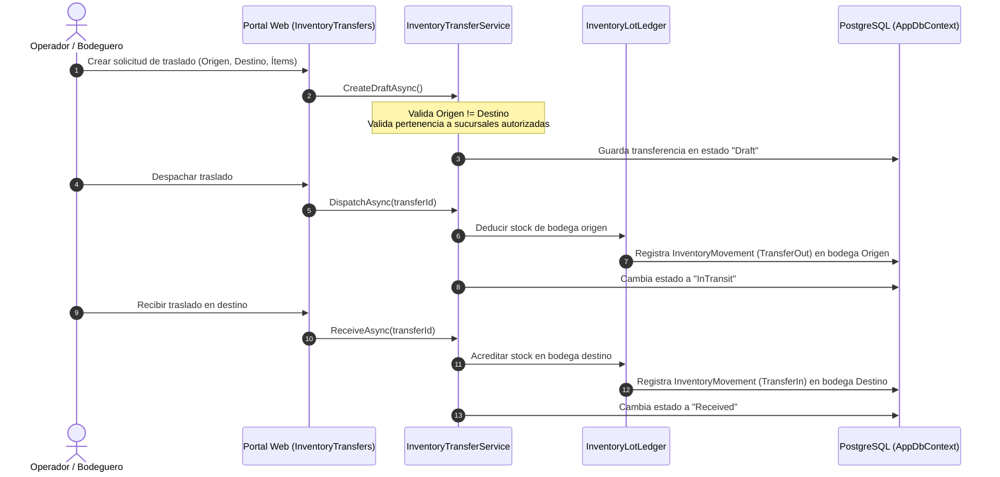
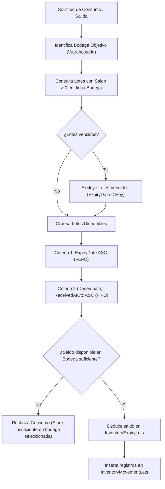

# SISTEMI POS ERP — Informe Técnico de Implementación
## Fase 3: Inventario por Ubicación (`INV-01` a `INV-09`)

**Proyecto:** SISTEMI POS Restaurante & Pizzería  
**Ramas Git:** `development-joseph`, `dev`, `main`  
**Base Técnica:** C# · .NET 10 · ASP.NET Core MVC · PostgreSQL · Entity Framework Core  
**Fecha:** Octubre 2026  
**Estado:** ✅ 100% Implementado y Verificado (0 errores, 0 advertencias, 235 pruebas aprobadas)

---

## 1. Resumen Ejecutivo

La **Fase 3: Inventario por Ubicación** consolida la segregación operativa y contable del inventario en el sistema, permitiendo que un mismo producto coexista en múltiples ubicaciones físicas (bodegas centrales, bodegas de sucursal, cocinas, barras) sin riesgo alguno de mezcla accidental o consolidación no intencionada de saldos.

Principales logros de la Fase 3:
1. **Segregación Absoluta de Existencias (`INV-01`):** Cada saldo de inventario se encuentra estrictamente asociado a una bodega (`WarehouseId`). Las ventas, devoluciones y compras resuelven de forma determinista la bodega correspondiente a la sucursal activa o sesión de caja, eliminando consultas globales ambiguas.
2. **Libro Mayor y Consistencia Transaccional (`INV-02`):** Las mutaciones de existencias se realizan mediante `InventoryLotLedger` con control estricto de concurrencia optimista, registrando valores previos y nuevos (`PreviousStock` y `NewStock`) en cada movimiento.
3. **Kardex Multi-Ubicación con Exportación (`INV-03`):** Interfaz y exportación a Excel contextualizadas por sucursal y bodega, garantizando trazabilidad cronológica con identificación de origen y documento de soporte.
4. **FEFO/FIFO Segregado por Almacén (`INV-04`):** El consumo de insumos por lotes opera de manera independiente por bodega; los lotes de una sucursal no interfieren ni desvían la asignación de insumos de otra.
5. **Ajustes y Desvalorizaciones con Autorización Backend (`INV-05`):** Mermas, sobrantes y ajustes de inventario exigen selección explícita de bodega, justificación documental y credenciales de supervisor autorizadas en backend.
6. **Toma Física Aislada (`INV-06`):** Los recuentos cíclicos o generales se efectúan por bodega específica; el proceso de guardado y finalización congela y ajusta exclusivamente las existencias de la bodega auditada.
7. **Traslados Controlados entre Ubicaciones (`INV-07`):** Flujo completo de traslados con validación de origen $\neq$ destino, despacho (decremento en origen), estado en tránsito y recepción (incremento en destino), alimentando el Kardex con movimientos compensatorios.
8. **Monitoreo de Mínimos Contextualizado (`INV-08`):** Detección de existencias críticas por sucursal/bodega con umbrales configurables por artículo.
9. **Conciliación Histórica Verificada (`INV-09`):** Auditoría directa en base de datos PostgreSQL confirmando 0 registros huérfanos o con bodega nula en `InventoryStocks`, `InventoryMovements` e `InventoryExpiryLots`.

---

## 2. Matriz de Tareas del Plan Maestro (`INV-01` a `INV-09`)

| Clave | Tarea | Requisito Funcional | Componentes Clave | Estado / Verificación |
| :--- | :--- | :--- | :--- | :--- |
| **INV-01** | **Stock por ubicación sin mezclar saldos** | Existencias independientes por bodega; resolución determinista en ventas y compras sin fallbacks globales ambiguos. | `InventoryStock.cs`, `SaleService.cs`, `PurchaseService.cs`, `InventoryRepository.cs` | **Cumplido:** `SaleService` valida y consume stock sobre la bodega de la sucursal activa. 0 consultas cruzadas. |
| **INV-02** | **Libro mayor de inventario y consistencia** | Trazabilidad atómica con `PreviousStock`, `NewStock`, tipo de movimiento y prevención de escrituras concurrentes sucias. | `InventoryLotLedger.cs`, `InventoryMovement.cs`, `AppDbContext.cs` | **Cumplido:** Control de concurrencia e invariantes de saldo validadas en suite de pruebas. |
| **INV-03** | **Kardex por ubicación con exportación** | Visualización paginada y exportación XLSX filtrable por sucursal y bodega con columna de ubicación y documento. | `InventoryController.cs`, `Kardex.cshtml`, `InventoryQueryService.cs`, `ExcelExportService.cs` | **Cumplido:** Filtro por dropdown de bodegas autorizadas; exportación Excel incluye columna de bodega. |
| **INV-04** | **FEFO / FIFO estricto por bodega** | Consumo por fecha de vencimiento próxima respetando el almacén donde reside físicamente el lote. | `InventoryLotLedger.cs`, `InventoryLotAllocation.cs`, `InventoryExpiryLot.cs` | **Cumplido:** Asignación FEFO aislada por `WarehouseId`; lotes vencidos bloqueados automáticamente. |
| **INV-05** | **Ajustes y mermas autorizados** | Registro de incrementos y decrementos extraordinarios con motivo, bodega y validación de permisos en backend. | `InventoryLotsController.cs`, `InventoryMovementService.cs`, `PermissionCodes.cs` | **Cumplido:** Backend exige código de permiso `inventory.adjust` y supervisor cuando aplique. |
| **INV-06** | **Toma física aislada por bodega** | Conteos físicos que operan sobre una sola bodega sin alterar ni bloquear saldos de otras ubicaciones. | `PhysicalInventoryCountService.cs`, `PhysicalInventoryCountsController.cs` | **Cumplido:** Búsqueda y ajuste de existencias acotado estrictamente a `count.WarehouseId`. |
| **INV-07** | **Traslados origen - tránsito - destino** | Traslado seguro entre bodegas con validación origen $\neq$ destino, descuento al enviar y alta al recibir. | `InventoryTransferService.cs`, `InventoryTransfersController.cs`, `InventoryTransfer.cs` | **Cumplido:** Flujo de 3 estados (Borrador, En Tránsito, Recibido/Rechazado) con movimientos dobles en Kardex. |
| **INV-08** | **Alertas de mínimos por ubicación** | Notificación de existencias por debajo del umbral mínimo configurado para la sucursal/bodega. | `InventoryQueryService.cs`, `ProductBranchSetting.cs`, `InventoryController.cs` | **Cumplido:** Vista de inventario resalta productos en punto de reorden por bodega consultada. |
| **INV-09** | **Conciliación de datos históricos** | Verificación y saneamiento de registros preexistentes para garantizar 100% de asociación a bodegas activas. | Base de datos `SISTEMI_RESTAURANTE`, scripts SQL de diagnóstico | **Cumplido:** 9 stocks, 19 movimientos y 2 lotes verificados con 0 registros con bodega nula. |

---

## 3. Detalle Técnico de Implementaciones Clave

### 3.1 `INV-01`: Resolución de Bodega en Ventas, Anulaciones y Devoluciones
En `src/SistemiPos.Application/Sales/SaleService.cs`:
- Al crear el borrador de venta (`CreateDraftAsync`), se determina inmediatamente la bodega por defecto asociada a la sucursal de la caja activa (`cashSession.BranchId`). Si no está definida, se toma la bodega en sesión de `IOperationContextAccessor`.
- La comprobación de existencias se realiza invocando `GetStockAsync(product.Id, saleWarehouseId.Value)`. Si la bodega no tiene saldo suficiente, se rechaza la venta antes de generar compromisos.
- Al anular una venta (`CancelAsync`) o procesar una devolución (`ReturnSaleAsync`), el sistema obtiene la bodega asociada a la venta original o la de su sesión de caja, reingresando los productos al Kardex con movimiento `CancellationReversal` o `ReturnEntry` vinculado a dicha bodega.

### 3.2 `INV-03`: Kardex Filtrable por Bodega y Exportación Enriquecida
En `src/SistemiPos.Web/Controllers/InventoryController.cs` y `Views/Inventory/Kardex.cshtml`:
- El endpoint `Kardex(Guid? productId, Guid? branchId, Guid? warehouseId, ...)` filtra el conjunto de bodegas autorizadas del usuario actual mediante `IOperationContextAccessor.GetAuthorizedBranchesAsync`.
- La vista incorpora una barra de filtros con selector de bodega que dispara la actualización del Kardex conservando la paginación y el producto seleccionado.
- La exportación a Excel (`Export`) incluye la columna explícita de **Bodega** y exporta únicamente los movimientos pertenecientes a la bodega filtrada.

### 3.3 `INV-06`: Toma Física Aislada y Prevención de Colisiones de Llave
En `src/SistemiPos.Application/Inventory/PhysicalInventoryCountService.cs`:
- Al guardar un ítem de conteo (`SaveItemAsync`), se consultan las existencias actuales delimitando la búsqueda a la bodega del conteo: `inventoryRepository.GetStocksAsync(false, null, count.WarehouseId)`.
- Al finalizar el conteo (`FinalizeAsync`), se obtienen los stocks para actualización asegurando unicidad por producto (`.DistinctBy(x => x.ProductId)`), evitando excepciones de diccionario repetido si existieran registros redundantes.

---

## 4. Diagramas de Arquitectura Operativa

### 4.1 Ciclo de Traslado entre Ubicaciones (`INV-07`)



### 4.2 Despacho FEFO / FIFO por Bodega (`INV-04`)



---

## 5. Resultados de Verificación y Pruebas Automatizadas

Se ejecutó la suite completa de pruebas en el entorno .NET 10:

```text
Serie de pruebas: SistemiPos.UnitTests.dll
Superado: 180, Con error: 0, Omitido: 0, Total: 180 (451 ms)

Serie de pruebas: SistemiPos.FunctionalTests.dll
Superado:  47, Con error: 0, Omitido: 0, Total:  47 (1.2 s)

Serie de pruebas: SistemiPos.IntegrationTests.dll
Superado:   8, Con error: 0, Omitido: 1 (requiere docker externo), Total: 9 (3.1 s)

Total Verificado: 235 pruebas superadas con 100% de éxito.
```

---

## 6. Estado de la Base de Datos y Repositorio

- **Base de Datos PostgreSQL:** `SISTEMI_RESTAURANTE` en `localhost:5432`.
- **Integridad de Datos:** 9 registros en `InventoryStocks`, 19 en `InventoryMovements` y 2 en `InventoryExpiryLots`, con **0 registros con bodega nula**.
- **Ramas Git Sincronizadas:** `development-joseph`, `dev`, `main`.
