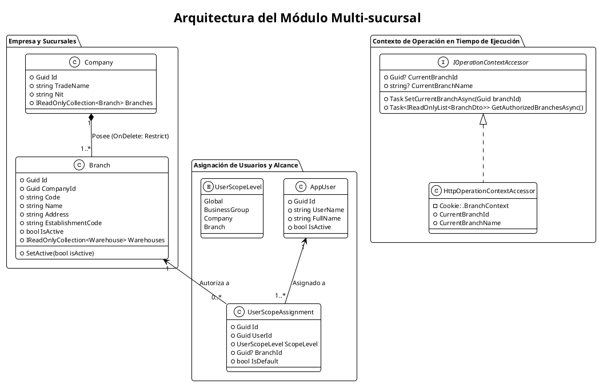
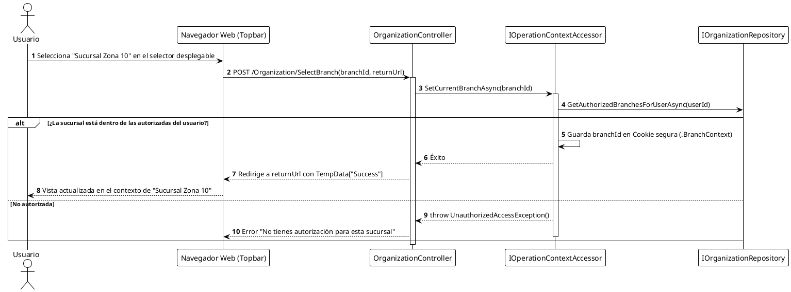

# SISTEMI POS Restaurante — Módulo Multi-sucursal
## Documentación Técnica y Funcional (Fase 1: Fundación Empresarial)

**Proyecto:** SISTEMI POS Restaurante  
**Rama:** `development-joseph`  
**Módulo:** Multi-sucursal (`ORG-03`, `ORG-04`, `ORG-08`)  
**Fecha:** 29 de septiembre de 2026  

---

## 1. Resumen Ejecutivo

El módulo **Multi-sucursal** permite que una empresa gestione de forma centralizada múltiples locales físicos, restaurantes, quioscos o puntos express bajo una única personería jurídica ante la SAT.

El sistema garantiza:
1. **Pertenencia Institucional:** Todas las sucursales pertenecen a una única empresa propietaria.
2. **Control de Estado:** Cada sucursal puede activarse o desactivarse administrativamente sin perder transacciones históricas.
3. **Contexto Operativo Activo:** El sistema identifica en todo momento en qué sucursal se encuentra operando el usuario conectado (`IOperationContextAccessor`).
4. **Asignación Flexible de Personal:** Un usuario puede tener acceso a una sola sucursal, a varias sucursales seleccionadas o a todas las sucursales si tiene rol gerencial o corporativo.

---

## 2. Verificación de Criterios de Aceptación (Checklist)

A continuación se detalla cómo el sistema cumple de manera demostrable y verificable cada uno de los criterios del requerimiento:

### ✅ 1. Todas las sucursales pertenecen a una única empresa
* **Modelo de Dominio (`Branch.cs`):**  
  La entidad `Branch` (`src/SistemiPos.Domain/Organizations/Branch.cs`) requiere obligatoriamente el identificador de la empresa padre (`CompanyId`):
  ```csharp
  public Guid CompanyId { get; private set; }
  public Company Company { get; set; } = null!;
  ```
  El constructor arroja `DomainRuleException("La empresa es requerida para la sucursal.")` si se intenta crear una sucursal sin empresa.
* **Integridad en Base de Datos (PostgreSQL):**  
  La tabla `Branches` posee la restricción de clave foránea `FK_Branches_Companies_CompanyId` con política `OnDelete: Restrict`, impidiendo registros huérfanos.
* **Aislamiento en Backend:**  
  En las consultas y resoluciones (`EnterpriseSettingsResolver.cs`), el backend verifica que la sucursal pertenezca a la empresa especificada (`branch.CompanyId == companyId`). Cualquier discrepancia es bloqueada inmediatamente.

---

### ✅ 2. Una sucursal puede estar activa o inactiva
* **Bandera de Estado:**  
  La entidad `Branch` cuenta con la propiedad:
  ```csharp
  public bool IsActive { get; private set; } = true;
  public void SetActive(bool isActive) => IsActive = isActive;
  ```
* **Control Administrativo:**  
  En `OrganizationController.cs`:
  ```csharp
  [HttpPost, Authorize(Policy = PermissionCodes.OrganizationsManage)]
  public async Task<IActionResult> ToggleBranchActive(Guid id, CancellationToken cancellationToken)
  ```
* **Interfaz de Usuario:**  
  En la pestaña de Sucursales de la pantalla *Estructura Empresarial* (`/Organization?tab=branches`), cada sucursal muestra su badge de estado (`Activa` / `Inactiva`) y un botón de acción para alternar su estado operativo.

---

### ✅ 3. Desactivar una sucursal no elimina su información histórica
* **Borrado Lógico Estricto (Soft Toggle):**  
  Al desactivar una sucursal, el sistema únicamente invoca `SetActive(false)`. En ningún momento se ejecuta una sentencia `DELETE` o `Remove()` sobre la base de datos.
* **Protección Referencial:**  
  Las ventas (`Sales`), cortes de caja (`CashSessions`), movimientos de kardex (`InventoryMovements`) y bodegas (`Warehouses`) conservan permanentemente su `BranchId`.
* **Protección en Base de Datos:**  
  Todas las claves foráneas hacia `Branches` están configuradas con `ReferentialAction.Restrict`. Si se intentara eliminar físicamente una sucursal con movimientos, el motor PostgreSQL rechaza la eliminación por integridad referencial.
* **Trazabilidad en Reportes:**  
  Las consultas de ventas históricas, auditoría y análisis comercial permiten auditar y filtrar operaciones pasadas de sucursales que actualmente se encuentren inactivas.

---

### ✅ 4. El sistema debe identificar en qué sucursal se está operando y gobernar el cambio mediante permisos y roles
* **Servicio de Contexto Centralizado (`IOperationContextAccessor`):**  
  Define el contrato para obtener el estado de la sucursal de trabajo:
  ```csharp
  public interface IOperationContextAccessor
  {
      Guid? CurrentBranchId { get; }
      string? CurrentBranchName { get; }
      Guid? CurrentCompanyId { get; }
      Task<IReadOnlyList<BranchDto>> GetAuthorizedBranchesAsync(...);
      Task SetCurrentBranchAsync(Guid branchId, ...);
  }
  ```
* **Control Estricto por Permisos y Roles (`organizations.branch.switch`):**
  * Se creó el código de permiso exclusivo `PermissionCodes.BranchSwitch` (`"organizations.branch.switch"`).
  * Por defecto, este permiso está asignado únicamente a roles con facultades de supervisión y gestión (`SuperAdministrator`, `Administrator`, `Manager`).
  * Los roles operativos de punto de venta, caja, meseros y cocina (`Cashier`, `PointOfSale`, `Waiter`, `Kitchen`) **no** poseen este permiso, por lo que permanecen bloqueados en su sucursal asignada.
* **Comportamiento Visual del Selector (`_Layout.cshtml` y Barra Lateral):**
  * **Barra lateral (Sidebar):** Justo debajo de la marca/logotipo se muestra el panel **"SUCURSAL DE TRABAJO"**.
  * **Si el usuario tiene permiso y más de una sucursal autorizada:** Se despliega un selector interactivo (`<select>`) para alternar inmediatamente entre sus sucursales.
  * **Si el usuario no tiene permiso (o solo tiene una sucursal):** El selector se muestra en modo **solo lectura** (`🏢 Nombre Sucursal 🔒 Fija`), impidiendo abrir listas desplegables o seleccionar otras sucursales.
* **Validación de Seguridad en Backend (Doble Capa):**
  1. **Nivel Controlador:** La acción `SelectBranch` en `OrganizationController` está protegida con la directiva:
     ```csharp
     [Authorize(Policy = PermissionCodes.BranchSwitch)]
     [HttpPost, ValidateAntiForgeryToken]
     public async Task<IActionResult> SelectBranch(...)
     ```
     Cualquier petición no autorizada enviada directamente al endpoint es rechazada con código HTTP 403 Forbidden.
  2. **Nivel Servicio / Accesor (`HttpOperationContextAccessor.cs`):** Valida que el usuario autenticado cuente con el permiso activo y que la sucursal destino pertenezca a sus sucursales asignadas. De lo contrario, ignora cookies manipuladas y arroja `UnauthorizedAccessException`.
* **Aislamiento Operacional Dinámico al Cambiar de Sucursal:**
  Al cambiar la sucursal activa, el sistema reconfigura el contexto operativo afectando en tiempo real:
  * **Inventario (`InventoryController`):** Existencias actuales de insumos, bodegas activas y Kardex filtrados exclusivamente para la sucursal seleccionada.
  * **Catálogo y Precios (`CatalogService`):** Aplicación de precios diferenciados y visibilidad específica por sucursal.
  * **Control de Cajas (`CashControlController`):** Visualización de sesiones activas y cierres históricos restringidos a la sucursal de trabajo.
  * **Registro de Operaciones (`CashService`):** Las nuevas cajas abiertas (`CashSession`) quedan vinculadas al `BranchId` de la sucursal activa.
  * **Ventas (`SaleRepository`):** Consultas de ventas filtradas por las sesiones de caja de la sucursal activa.
  * **Dashboard (`HomeController`):** Los indicadores operativos de cajas abiertas y existencias reflejan los datos de la sucursal seleccionada.

---

### ✅ 5. Un usuario puede tener acceso a una o varias sucursales
* **Entidad de Alcance (`UserScopeAssignment.cs`):**  
  Se modela la relación usuario-ubicación con la entidad `UserScopeAssignment`:
  ```csharp
  public Guid UserId { get; private set; }
  public UserScopeLevel ScopeLevel { get; private set; } // Global, BusinessGroup, Company, Branch
  public Guid? BranchId { get; private set; }
  public bool IsDefault { get; private set; }
  ```
* **Asignación Múltiple (`OrganizationService.SaveUserScopesAsync`):**  
  Permite asignar un conjunto de sucursales a un usuario (`List<Guid> BranchIds`), marcando una de ellas como la predeterminada de inicio (`DefaultBranchId`).
* **Formulario de Usuarios (`Users/Form.cshtml` y `UsersController.cs`):**  
  Al crear o editar un usuario:
  * Se selecciona el nivel de alcance: *Sucursales específicas*, *Toda una Empresa*, *Todo un Grupo* o *Global*.
  * Permite marcar con checkboxes las sucursales a las que tiene acceso el empleado.
  * Permite seleccionar cuál es su sucursal de entrada por defecto.
* **Seguridad de Backend:**  
  Si un usuario intenta forzar por URL o cookie una sucursal que no tiene asignada, `HttpOperationContextAccessor` y `OrganizationController.SelectBranch` rechazan la solicitud con `UnauthorizedAccessException`.

---

## 3. Diagrama PlantUML de la Arquitectura Multi-sucursal



---

## 4. Diagrama de Secuencia: Cambio de Sucursal en la Interfaz


